# claude-faceless-shorts-creator

**A faceless video factory you drive with [Claude Code](https://claude.com/claude-code).**
Fourteen production tracks in one repo — you describe the video (or paste a full script —
every track adapts your words, never rewrites them), and the right pipeline runs:

| You say… | Track | The pixels |
|---|---|---|
| *"here's my script — use everything, make it your best"* · *"on script"* · *"flagship"* | **Flagship** (`/make-on-script`) | the **all-in-one conductor**: the minimal-reel host system + ONE routed guest mechanism per beat (math counters, iso diagrams, pixel eras, torn paper, riso overprint, kinetic type…) — every strength in the repo under one finish |
| *"make a short about the ×11 trick"* · *"here's my script, make it a short"* | **TSX** (`/make-short`) | 100% code — a [Remotion](https://remotion.dev) composition, no footage, no stock |
| *"make an AI video short with blue-man"* | **Generative** (`/make-ai-short`) | a fal video model animating a **locked recurring character** |
| *"make a vox-style short about coffee"* | **Collage** (`/make-vox`) | Vox-documentary paper collage — AI-image layers, die-cuts, a traveling camera |
| *"make a map film about the Strait of Hormuz"* | **Map** (`/make-map`) | a **data-driven animated map** at 3 detail levels (110m/50m/10m) — fly-to camera grammar, zoom-band labels, region-change transients, war-room documentaries in one continuous shot |
| *"make a motion-graphics reel"* | **Motion design** (`/make-motion-graphics`) | a **real motion-design system** — kinetic-typography atoms, shape grammar, grid cascades, counters, Material-style transitions; type + shapes + limited palette only, no photos |
| *"make a minimal metaphor reel"* | **Minimal** (`/make-minimal-reel`) | three physical metaphors — layered cut-outs, drawn shapes, optional 3D eye — under one paper/halftone finish at 15fps |
| *"animate the history of the bicycle in cut paper"* (or crosshatch, riso, sketchbook, math, pixel, isometric) | **Animate styles** (7 tracks) | procedural canvas animation — one file, drawn + scored in code, MP4 via headless Chromium + ffmpeg. The [cth9191/animate](https://github.com/cth9191/animate) engine with the style pinned: `/make-cut-paper` `/make-crosshatch` `/make-riso` `/make-sketchbook` `/make-math` `/make-pixel` `/make-isometric` |
| *"review this cut"* | **Critic** (`/review-cut`) | the Gauntlet: fresh critics, real frames, measured audio, SHIP / ONE MORE PASS |

Every track shares the same backbone: **script-first intake** (bring your own script — it
gets adapted, never rewritten, with one confirmation round before anything is built), a
voiceover with **word-exact synced captions** (Edge TTS by default — free, you pick the
voice name; ElevenLabs optional), a `beats.json` machine contract, the **MOTION.md motion
grammar + quality bar** (six rules, composition density, pacing numbers, a reusable
mechanism catalog), frame-by-frame QA at phone scale, **measured QA** (frozen-time,
loudness and determinism scripts) plus the on-mute payoff test, a reusable self-growing
SFX/music library, seamless frame-0==last-frame loops, and no dated engagement-CTA outros.

## 🎬 Example films

Every production track ships at least one complete example film — built by running the
track's own `SKILL.md` end to end (script → voice → composition → SFX → measured QA →
render), then published via [GitHub Releases](https://github.com/Ziruax/make-videos/releases).
Each preview below autoplays as a silent looping GIF — **click it for the full film**
(MP4 with voice and sound design, straight from its release).

### `/make-on-script` — the all-in-one flagship

**The One Percent Rule** · 1080×1920 · 15fps · 25.6s — the proof piece for the fusion
architecture: a six-line script (kept **verbatim**), the minimal-reel host (ivory/teal/ink
+ gold, paper/halftone finish, camera continuity) conducting four routed guests — torn
paper for the overload, an isometric add-vs-multiply stage for the mechanism, a serif
counter landing ×37.8 on the spoken word, and a kinetic fly-through for "INEVITABLE".
One finish, one palette, one arc; the best machinery of the repo quietly doing the work.
All on-screen math true (1.01³⁶⁵ = 37.8 · 0.99³⁶⁵ = 0.03), the towers at honest 1:8
proportion, and the twist is the same mechanism gone to zero.

[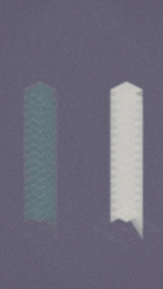](https://github.com/Ziruax/make-videos/releases/download/example-on-script-1/os-1-one-percent.mp4)

Project: [`on-script/os-1-one-percent/`](on-script/os-1-one-percent/) · composition:
[`Os1OnePercent.tsx`](remotion/src/shots/os-1/Os1OnePercent.tsx) + scenes S1–S3 · fusion
kit: [`fusion.tsx`](remotion/src/lib/fusion.tsx) · host kit:
[`tactile.tsx`](remotion/src/lib/tactile.tsx) ·
[release](https://github.com/Ziruax/make-videos/releases/tag/example-on-script-1)

### `/make-short` — the TSX track

**The Traffic Jam With No Cause** · 1080×1920 · 41s — a ring road of 22 simulated cars with
no accident and no closed lane… and a phantom traffic wave that emerges anyway and travels
*backwards*. The simulation was measured first (the wave really moves at −17.9 km/h), then
the script was written around the measurement — captions hit the exact spoken word.

[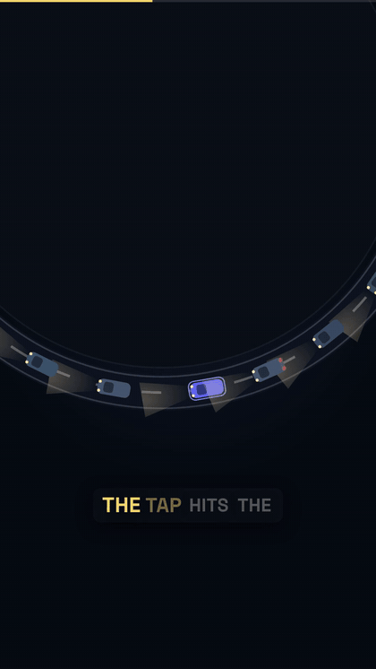](https://github.com/Ziruax/make-videos/releases/download/example-short-13/short-13-emergence.mp4)

Project: [`shorts/short-13-emergence/`](shorts/short-13-emergence/) · composition:
[`Short13Traffic.tsx`](remotion/src/shots/short-13/Short13Traffic.tsx) ·
[release](https://github.com/Ziruax/make-videos/releases/tag/example-short-13)

### `/make-map` — animated-map documentaries

**Six Days, One Ship, $9.6 Billion** · 1920×1080 · 34s — the 2021 Suez blockage as a
war-room map documentary: 369 ships queued behind one wedge of steel, tugs and dredgers
arriving on the full-moon tide. The whole film is **one continuous camera shot** across a
data-driven d3-geo map — outlines draw themselves, figures rise out of the map.

[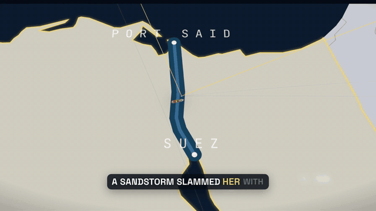](https://github.com/Ziruax/make-videos/releases/download/example-map-1/map-1-suez.mp4)

Project: [`map-films/map-1-suez/`](map-films/map-1-suez/) · composition:
[`Map1Suez.tsx`](remotion/src/shots/map-1/Map1Suez.tsx) · shared kit:
[`mapkit.tsx`](remotion/src/lib/mapkit.tsx) ·
[release](https://github.com/Ziruax/make-videos/releases/tag/example-map-1)

### `/make-motion-graphics` — motion-design reels

**Kodak vs The Future** · 1080×1920 · 40s — *the track's first-generation example (photo-cutout
documentary collage; the track has since been rebuilt end-to-end as a true motion-design system:
kinetic type, shapes, grids, data motion, no photos)* — Kodak invented the digital camera in 1975,
and the company that owned photography still went bankrupt in 2012. The voiceover was
locked **first** (the VO *is* the source code), then six scenes were built around it on a
12fps stop-motion engine: zoom-through-frame, screen-blend smoke, slot-machine text,
parallax punch, drawn lamp light, a decaying foam finger — under an aged-film treatment.

[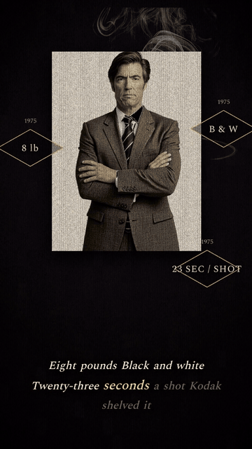](https://github.com/Ziruax/make-videos/releases/download/example-mg-1/mg-1-kodak.mp4)

Project: [`mg-reels/mg-1-kodak/`](mg-reels/mg-1-kodak/) · composition:
[`Mg1Kodak.tsx`](remotion/src/shots/mg-1/Mg1Kodak.tsx) + scenes S1–S6 ·
[release](https://github.com/Ziruax/make-videos/releases/tag/example-mg-1)

### `/make-minimal-reel` — tactile metaphor reels

**What Attention Costs** · 1080×1920 · 15fps · 22s — a five-line arc about attention as a
spent resource: a scanning eye, a battery that flickers under doubt, an iceberg whose 90%
was always underwater. Camera-continuity transitions (pupil portal, recede-and-blur,
scale+blur settle), two kinds of texture, stepped ignition flicker — everything under one
paper/halftone finish at 15fps, where every frame is a *felt* frame.

[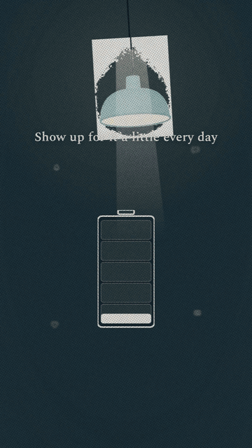](https://github.com/Ziruax/make-videos/releases/download/example-mr-1/mr-1-attention.mp4)

Project: [`minimal-reels/mr-1-attention/`](minimal-reels/mr-1-attention/) · composition:
[`Mr1Attention.tsx`](remotion/src/shots/mr-1/Mr1Attention.tsx) + scenes S1–S3 · shared kit:
[`tactile.tsx`](remotion/src/lib/tactile.tsx) ·
[release](https://github.com/Ziruax/make-videos/releases/tag/example-mr-1)

### `/make-vox` — layered-collage documentaries

**The Lines That Never Left** · 1080×1920 · 40s — the Berlin Conference, 1884: fourteen
European powers drawing the borders of a continent none of them lived on, while no African
sat in the room. Every scene is dissected into layers on one paper board — the archival
photo lands ON the map and the camera dives INTO it; the 1880 map is **overwritten in
place** by the 1914 partition; a ruler and pen draw the straight lines that outlived
their authors.

[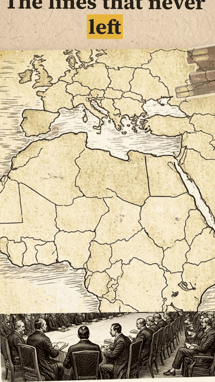](https://github.com/Ziruax/make-videos/releases/download/example-vox-2/vox-2-africa.mp4)

Project: [`vox-shorts/vox-2-africa/`](vox-shorts/vox-2-africa/) · composition:
[`Vox2Africa.tsx`](remotion/src/shots/vox-2/Vox2Africa.tsx) · shared kit:
[`collage.tsx`](remotion/src/lib/collage.tsx) ·
[release](https://github.com/Ziruax/make-videos/releases/tag/example-vox-2)

> The `/make-ai-short` track needs a `FAL_KEY` and a locked character to generate video-model
> clips, so it has no example film here yet — everything above is 100% reproducible from the
> committed compositions.

### The animate-style tracks — procedural canvas animation (7 styles)

Seven new tracks pin the [animate](https://github.com/cth9191/animate) engine to one style
each: **`/make-cut-paper`** (torn-paper collage worlds joined by shape-morphs) ·
**`/make-crosshatch`** (boiling ink line, hatched shading, navy "inside the machine"
worlds) · **`/make-riso`** (a three-ink risograph print — halftone screens, overprints,
misregistration) · **`/make-sketchbook`** (graphite + one accent on a real sketchbook
page, everything drawn on) · **`/make-math`** (manim-style explainer — written formulas,
swept axes, transforms, honest readouts) · **`/make-pixel`** (true low-resolution pixel
art that sharpens as eras advance) · **`/make-isometric`** (hairline isometric product
line art, spring settles). Same story grammar, timing, synthesized score and measured
review for all; the style supplies the drawing kit. Voice via Edge TTS with real word
times (`tools/gen_takes_edge.py` → `voice.mjs`), so the picture cues on the words.

#### `/make-sketchbook` — *The Five Folds* · 36.9s

A how-to on one sketchbook page, and it's true physics: five folds drawn
pencil-first, ink-after; the secret — one tiny fold at the nose that shifts
the weight ahead of the lift — gets the page's single highlighter swipe and
a hand-drawn weight-vs-lift diagram. Then THE LAUNCH: a shape morph where
the folded dart becomes the flying plane, the payoff hit landing in 0.7s of
scored silence. The glide, the loop, the check mark. Go make one.

[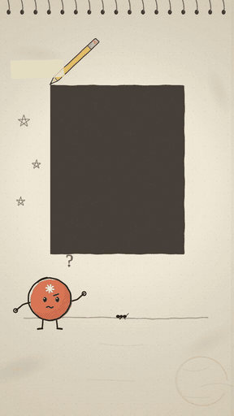](https://github.com/Ziruax/make-videos/releases/download/example-sketchbook-1/sketchbook-1-folds.mp4)

Piece: [`pieces/sk-1-folds/`](pieces/sk-1-folds/) · brief:
[`brief.md`](pieces/sk-1-folds/brief.md) ·
[release](https://github.com/Ziruax/make-videos/releases/tag/example-sketchbook-1)

#### `/make-riso` — *The Mirror Wave* · 27.8s

How noise cancelling works, printed in three inks: the engine drone is pink
waves washing the cabin, the chip flips one upside down into a teal mirror,
and where peak meets trough the print knocks out to paper — the medium's own
white IS the silence. The piece performs its own subject: the synthesized
drone hard-stops at the slam and never comes back.

[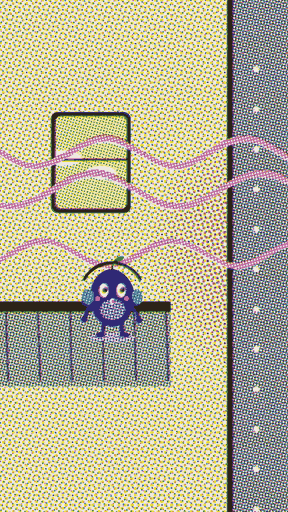](https://github.com/Ziruax/make-videos/releases/download/example-riso-1/riso-1-mirror.mp4)

Piece: [`pieces/riso-1-mirror/`](pieces/riso-1-mirror/) · brief:
[`brief.md`](pieces/riso-1-mirror/brief.md) ·
[release](https://github.com/Ziruax/make-videos/releases/tag/example-riso-1)

#### `/make-crosshatch` — *What Happens When You Press Enter* · 33.6s

One command's round trip: you type `ls`, press Enter, and the terracotta dot
— the command itself — rides the pipeline. The shell parses the line, forks
a copy of itself, execs the real program, asks the kernel, the kernel asks
the disk, and the names rush back as bytes to write themselves on your
screen. Warm paper userland by day, navy machine worlds by night; the payoff
is a stopwatch: 0.003 s.

[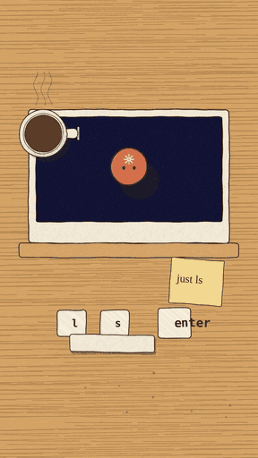](https://github.com/Ziruax/make-videos/releases/download/example-crosshatch-1/crosshatch-1-enter.mp4)

Piece: [`pieces/ch-1-enter/`](pieces/ch-1-enter/) · brief:
[`brief.md`](pieces/ch-1-enter/brief.md) ·
[release](https://github.com/Ziruax/make-videos/releases/tag/example-crosshatch-1)

#### `/make-cut-paper` — *The Bean That Woke the World* · 37.7s

A history of coffee in six full-bleed torn-paper worlds: the dancing-goat
legend, the Yemeni monks who brewed the night through, London's penny
universities, the 1727 seedling smuggled into Brazil — sprouting in 1.3s of
scored silence before the slam — and today's two billion cups. The spark gains
a ray everywhere coffee lands; the cherry loops the piece: cherry → bean →
pot → cup → cherry.

[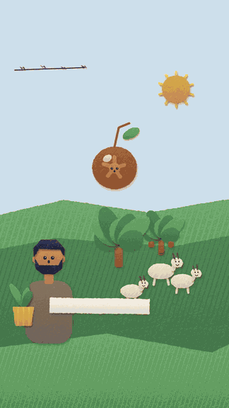](https://github.com/Ziruax/make-videos/releases/download/example-cut-paper-1/cut-paper-1-coffee.mp4)

Piece: [`pieces/cp-1-dancing-goats/`](pieces/cp-1-dancing-goats/) · brief:
[`brief.md`](pieces/cp-1-dancing-goats/brief.md) ·
[release](https://github.com/Ziruax/make-videos/releases/tag/example-cut-paper-1)

#### `/make-math` — *Every Triangle Hides a Straight Line* · 10.4s

A proof, shown not asserted: a 3-4-5 triangle gives up its three corner wedges
(53.13° + 36.87° + 90°), and they fly to a straight line, filling exactly the
upper half-disc. A live readout counts to 180 and lands on the spoken word
"eighty"; the flash payoff sits in 0.7s of scored silence.

[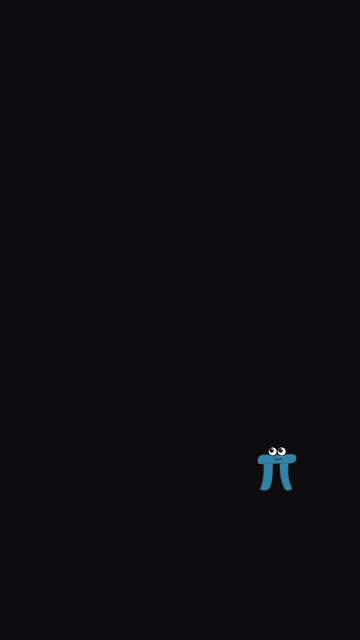](https://github.com/Ziruax/make-videos/releases/download/example-math-1/tri-180-angles.mp4)

Piece: [`pieces/tri-180/`](pieces/tri-180/) · brief:
[`brief.md`](pieces/tri-180/brief.md) ·
[release](https://github.com/Ziruax/make-videos/releases/tag/example-math-1)

#### `/make-pixel` — *One Square, Fifty Years* · 37.7s

Resolution tells time. Four eras, each drawn at its TRUE low resolution and
scaled up nearest-neighbour: a 54×96 black-and-white CRT (1972 — Pong's
square ball), a 90×160 four-green handheld (1989 — the square is a life),
a 180×320 16-bit world (color, parallax, the square spins as a coin), and
today's 360×640 phone home screen — where the square is an app icon and
the payoff counts this very screen's pixels: 2,073,600. The goodbye
bounces the icon like Pong's ball, paddles and all. The ball never
stopped bouncing.

[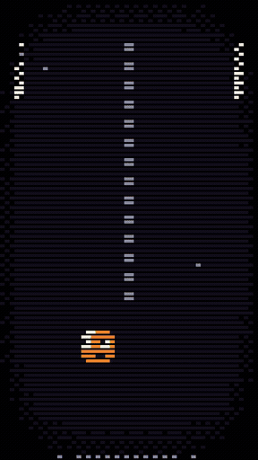](https://github.com/Ziruax/make-videos/releases/download/example-pixel-1/pixel-1-square.mp4)

Piece: [`pieces/px-1-square/`](pieces/px-1-square/) · brief:
[`brief.md`](pieces/px-1-square/brief.md) ·
[release](https://github.com/Ziruax/make-videos/releases/tag/example-pixel-1)

#### `/make-isometric` — *Fifteen Milliseconds* · 33.5s

A hard drive drawn as it truly is, in hairline isometric line art: the
sealed box drops in; the lid opens on its hinge — a true cutaway; two
platters spin at 7200 RPM; the arm's dark head never touches the surface,
flying on a cushion of air nanometers above the platter; you save a file
and it seeks. Then the payoff, in 1.2 seconds of scored silence: two bars
at true proportion — a blink of your eye (300 ms) versus the arm crossing
the entire disc (15 ms). Twenty to one. The lid closes: seventy years
old, and still spinning your files.

[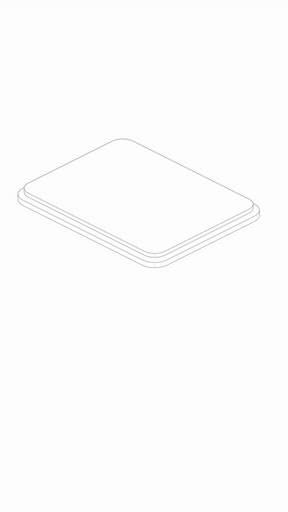](https://github.com/Ziruax/make-videos/releases/download/example-isometric-1/iso-1-seek.mp4)

Piece: [`pieces/iso-1-seek/`](pieces/iso-1-seek/) · brief:
[`brief.md`](pieces/iso-1-seek/brief.md) ·
[release](https://github.com/Ziruax/make-videos/releases/tag/example-isometric-1)

Style routing index:
[`.claude/skills/animate-styles-README.md`](.claude/skills/animate-styles-README.md).

## 📖 Read the guide

I wrote up the whole system on my site, including the six-beat grammar that decides whether a
40-second short is worth finishing:
**[Make Faceless YouTube Shorts With Claude Code](https://learnwithhasan.com/guide/how-to-make-faceless-youtube-shorts-with-claude-code/?utm_source=github&utm_medium=readme&utm_campaign=claude-faceless-shorts-creator&utm_content=body)**

Free to read, no login. More build guides at
**[learnwithhasan.com/guides](https://learnwithhasan.com/guides/?utm_source=github&utm_medium=readme&utm_campaign=claude-faceless-shorts-creator&utm_content=body)**.

## The example videos (more coming)

**TSX shorts** (`shorts/`) — 12 complete productions; each folder has the script, beats
contract, and SFX cue sheet, and the committed composition renders the exact video:

| # | Niche | Title / hook |
|---|---|---|
| 1 | Chess | The 4-Move Checkmate — Punished |
| 2 | Math | The ×11 Trick |
| 3 | Algorithms | Bubble vs Quick: The Race |
| 4 | Dev tips | `git reflog` undoes any mistake |
| 5 | Probability | Monty Hall, Finally Intuitive |
| 6 | Excel | Excel Reads Your Mind (Flash Fill / Ctrl+E) |
| 7 | Kids story | Little Pip (AI-image storybook, ages 4–6) |
| 8 | Cybersecurity | The URL That Isn't PayPal |
| 9 | Music theory | The 4 Chords In Every Hit |
| 10 | Money math | The 1% Fee That Eats 24% Of Your Retirement |
| 11 | Geography | The Map Lied To You |
| 12 | Physics | Astronauts Aren't Weightless. They're Falling. |

**Generative** (`ai-shorts/blue-man/`) — *The Door*: a clay-render character walking through
doors across worlds, thesis "arrival is a myth". Includes the **locked character sheet**
(`character.json` + reference PNG), the model bake-off records (Seedance vs Kling vs Veo, with
derived per-second costs), and the six generated clips — committed, because video-model pixels
are not reproducible.

**Collage** (`vox-shorts/vox-1-coffee/`) — a Vox-style documentary short on coffee's journey:
generated map/archival/cutout layers (committed), a camera choreographed across scenes, and
`DESIGN.md` — the full visual-language spec of the collage engine.

Rendered videos aren't committed (they're reproducible from the repo); the example films
above are published as [GitHub Release assets](https://github.com/Ziruax/make-videos/releases)
(each GIF in the showcase links to its film's MP4).

## How a short gets made

```
topic ──▶ script.md + beats.json      the beat grammar: HOOK (frame 0 = the thumbnail)
                │                      → SETUP → QUIZ → REVEAL → TWIST → seamless LOOP
                ▼
        the visuals                    TSX composition / video-model clips / collage layers /
                │                      map data / film-look cutouts / typography
                ▼                      (per track — but always ONE Remotion timeline)
        frame-by-frame QA              Claude renders PNGs at phone scale and READS them,
                │                      then MEASURES the cut (frozen-time, loudness)
                ▼
        gen_voice_edge.py              Edge TTS per line (free, user-picked voice) → REAL
                │                      per-word timestamps → captions highlight on the
                ▼                      exact spoken word (ElevenLabs optional)
        sfx-plan.json + mix_sfx.py     library-first sound design, audition mix, your ear
                │                      is the final gate (optional music bed: mix_music.py)
                ▼
        <track>/<project>/output/*-sfx.mp4      (+ /review-cut critic rounds on flagships)
```

Thirteen Claude Code **skills** encode the craft (the animate styles add seven more
wrappers):

- **`/make-on-script`** — the all-in-one flagship: minimal-reel host + one routed guest
  mechanism per beat (the routing table is the skill's core), the three laws of fusion,
  script-first verbatim intake, the full measured-QA pipeline.
- **`/make-short`** — the TSX pipeline: hook grammar, no-CTA outros, caption safe areas,
  Sequence-local frame math, loop-into-intro endings, motion grammar from 28 pro launch films.
- **`/make-ai-short`** — the generative pipeline and its three iron rules: never regenerate a
  locked character from text, state the cost before spending it, loop by end-frame constraint.
- **`/make-vox`** — scene dissection into layers, cheapest-source layer production
  (gen_image + rembg cutouts, HTML→PNG, SVG-in-TSX), CollageBoard camera choreography.
- **`/make-map`** — data-driven map documentaries: world-atlas/TopoJSON/d3-geo, glowing
  self-drawing outlines, cutout figures rising out of the map, screen-blend VFX, the
  one-continuous-shot continuity rule, `--gl=angle` grain rendering.
- **`/make-motion-graphics`** — documentary story reels: the VO-as-source-code rule, the
  12fps stop-motion engine, the film-look treatment, signature moves (zoom-through-frame,
  screen-blend smoke, slot-machine text, parallax punch, drawn lamp light, decaying wag).
- **`/make-minimal-reel`** — tactile metaphor reels: VO-first 5-line arc, one metaphor
  per scene (scanning eye → charging battery → iceberg), 3-colour palette with two
  lighting conditions, camera-continuity transitions, the shared halftone/paper/grain
  finish, SFX that follow the animation controls.
- **`/review-cut`** — the Gauntlet: fresh critics, real frames, measured audio, item-by-item
  verification, SHIP / ONE MORE PASS.
- **`/vidtsx-2d-generator`** — the TSX authoring rules that keep Remotion renders from crashing.
- **`/suggest-sfx`** — taste-encoded sound design: function-first cues, layered hero moments,
  measured audibility (RMS-diff, not hope), a library that compounds across videos.

`brand.md` is the style contract (palette, type, motion, SFX taste) — swap it for your own
brand and every future video follows it.

## Quickstart

Requirements: [Claude Code](https://claude.com/claude-code) · Node 18+ · Python 3.10+ ·
`ffmpeg` on PATH · `pip install edge-tts` (voice — free, no key). Optional extras: an
[ElevenLabs](https://elevenlabs.io) key (emotion-tagged voice/SFX/music); a [fal.ai](https://fal.ai)
key for the generative track; for collage layer production and map films:
`pip install pillow rembg playwright && playwright install chromium`; maps also need
`npm install world-atlas topojson-client d3-geo d3-scale zod@4.3.6` in `remotion/`.

```bash
git clone https://github.com/hassancs91/claude-faceless-shorts-creator
cd claude-faceless-shorts-creator
cp .env.example .env          # add keys only if you use them (Edge TTS needs none)
cd remotion && npm install && npm run gen && cd ..

claude                        # open the repo in Claude Code, then:
```

> **make a short about &lt;your topic&gt;** · **make an AI video short about &lt;idea&gt;** ·
> **make a vox-style short about &lt;story&gt;** · **make a map film about &lt;conflict&gt;** ·
> **make a documentary reel about &lt;company story&gt;** · **make a minimal reel about &lt;idea&gt;**

…or rebuild an example: *"re-render short-5, regenerate its voice with en-GB-RyanNeural"*.

To just explore the compositions visually: `cd remotion && npm run studio`.

## Repo layout

```
.claude/skills/   the nine skills (this is where the "editor" lives)
tools/            Python: gen_voice_edge, gen_voice, gen_sfx, gen_music, mix_sfx, mix_music,
                  gen_image, gen_clip, bakeoff_clip, cutout, capture_web, gen_chords +
                  qa_frozen_time.sh, qa_loudness.sh
remotion/         the Remotion project — shared kits in src/lib/ (shorts, engine, filmlook,
                  collage + niche kits), one folder per video in src/shots/
media/library/    reusable assets: SFX clips + music beds (catalogued, loudness-normalized)
media/projects/   media for one specific video — incl. committed AI clips & collage layers
shorts/           the 12 TSX example productions
ai-shorts/        the generative track: blue-man/ (locked character) + IDEAS.md (cost tables)
vox-shorts/       the collage track: vox-1-coffee/ + DESIGN.md (the visual language)
map-films/        animated-map documentaries
mg-reels/         documentary motion-graphics reels
minimal-reels/    tactile metaphor minimal reels
brand.md          the style contract — make it yours
IDEAS.md          the TSX-shorts niche/idea bank
```

## Credits

Original factory by **[Hasan Aboul Hasan](https://learnwithhasan.com/)** (MIT). This fork
enriches the workflow with techniques studied from the MoSidd practice kits (map
documentaries; documentary motion-graphics reels — the *techniques* only, their example
media is not redistributed) and from
[echris6/motion-video-kit](https://github.com/echris6/motion-video-kit) (the Gauntlet
critic loop, motion grammar, quality bar, audio rules — MIT). Bundled SFX/music clips were
generated by the repo author and are redistributed here; per-clip provenance is recorded
in `media/library/*/catalog.json`.

## License

MIT — see [LICENSE](LICENSE).

<!-- lwh-footer -->

---

## 📘 The free book

This repo is one thing I built with AI. The book is the system underneath it.

**[Vibe Engineering Blocks](https://learnwithhasan.com/blocks/?utm_source=github&utm_medium=readme&utm_campaign=claude-faceless-shorts-creator&utm_content=footer)** is my free 74-page book.
47 building blocks for shipping real apps with AI. One block per page, each with the exact
prompt to hand your AI.

Built by **[Hasan Aboul Hasan](https://learnwithhasan.com/?utm_source=github&utm_medium=readme&utm_campaign=claude-faceless-shorts-creator&utm_content=footer)**. I build real products with AI and
write down exactly how.
[Guides](https://learnwithhasan.com/guides/?utm_source=github&utm_medium=readme&utm_campaign=claude-faceless-shorts-creator&utm_content=footer) &nbsp;·&nbsp;
[YouTube](https://www.youtube.com/@HasanAboulHasan) &nbsp;·&nbsp;
[Community](https://learnwithhasan.com/community/)
